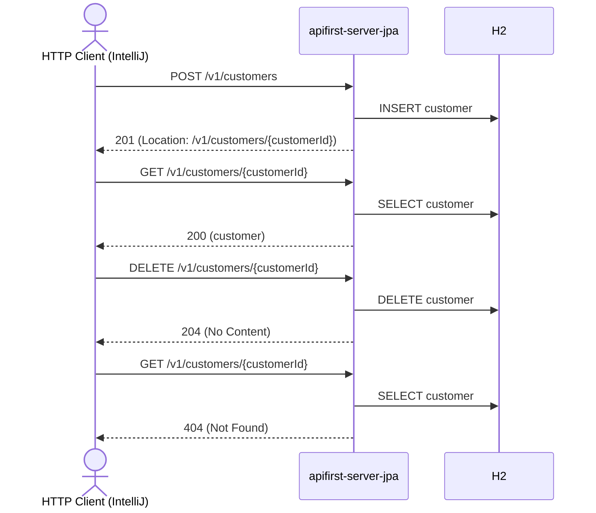

# customer Flow: createCustomer → getCustomerById → deleteCustomer → getCustomerById (404)

Datei:
`restRequest/customer-flow-create-get-delete/customer-flow-create-get-delete.http`

## Ziel

Einen frischen Kunden anlegen, holen, löschen und das Löschen verifizieren — deterministisch, ohne
FK-Konflikt (ein frischer Kunde hat keine Orders).

## Voraussetzung

Nur mit dem JPA-Profil lauffähig (`local-with-jpa` = 8082, `k8s-wiht-jpa` = 30082):
`DELETE /v1/customers/{customerId}` ist in `apifirst-server` nicht implementiert.

## Ablauf (Services)

## Requests (in dieser Reihenfolge)

1. `createCustomer` – legt einen frischen Kunden an; `customerId` kommt aus dem `Location`-Header.
2. `getCustomerById` – holt den Kunden per `customerId` (Pre-Request-Skript prüft, dass sie gesetzt ist).
3. `deleteCustomerById` – löscht den Kunden per `customerId`.
4. `getCustomerById` – bestätigt `404 Not Found`.

## Benötigte Globals

|       Global        |          gesetzt von           |       genutzt von       |
|---------------------|--------------------------------|-------------------------|
| `customerId`        | `createCustomer` (Location)    | alle folgenden Requests |
| `traceId`, `spanId` | `../../scripts/traceparent.js` | alle Requests           |

## Asserts

- `createCustomer` → `201`, `Location`-Header gesetzt.
- `getCustomerById` → `200`, `id` entspricht `{{customerId}}`.
- `deleteCustomerById` → `204`.
- `getCustomerById` (nach Delete) → `404`.

## Hinweise

- Ein Kunde **mit** Orders liefert beim Löschen `409 Conflict` (siehe
  `CustomerServiceImpl.deleteCustomer`).

