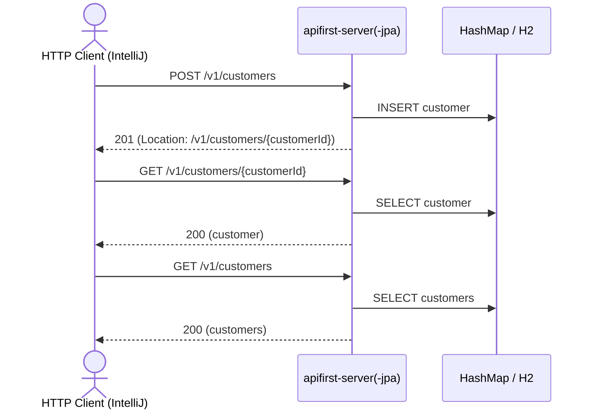

# customer Flow: createCustomer → getCustomerById → listCustomers

Datei: `restRequest/customer-flow-create-get-list/customer-flow-create-get-list.http`

## Ziel

Einen frischen Kunden anlegen, per ID abrufen und in der Liste wiederfinden. Läuft auf beiden
Profilen (`local` = `apifirst-server`, `local-with-jpa` = `apifirst-server-jpa`).

## Ablauf (Services)

## Requests (in dieser Reihenfolge)

1. `createCustomer` – legt einen frischen Kunden an; das Post-Request-Skript liest `customerId` aus dem
   `Location`-Header.
2. `getCustomerById` – holt den Kunden per `customerId`; das Pre-Request-Skript prüft, dass
   `customerId` gesetzt ist.
3. `listCustomers` – prüft, dass der angelegte Kunde in der Liste enthalten ist.

## Benötigte Globals

|       Global        |         gesetzt von         |            genutzt von             |
|---------------------|-----------------------------|------------------------------------|
| `customerId`        | `createCustomer` (Location) | `getCustomerById`, `listCustomers` |
| `traceId`, `spanId` | `../scripts/traceparent.js` | alle Requests                      |

## Asserts

- `createCustomer` → `201`, `Location`-Header gesetzt, `customerId` lesbar.
- `getCustomerById` → `200`, `id` entspricht `{{customerId}}`, Name entspricht dem Payload.
- `listCustomers` → `200`, Liste enthält `{{customerId}}`.

## Hinweise

- Basis-URL ist `{{application-port}}` (Profil `local` = 8081, `local-with-jpa` = 8082,
  `k8s` = 30081, `k8s-with-jpa` = 30082).
- `createCustomer` liefert einen leeren Body; die neue ID steht nur im `Location`-Header.
- `getCustomerById` liefert `404 Not Found`, wenn der Kunde nicht existiert.

