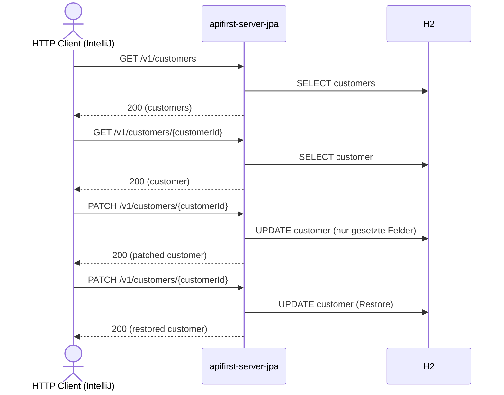

# customer Flow: listCustomers → getCustomerById → patchCustomerById → restore

Datei: `restRequest/customer-flow-list-get-patch/customer-flow-list-get-patch.http`

## Ziel

Einen bestehenden Kunden aus der Liste auswählen, holen, partiell aktualisieren (PATCH) und den
ursprünglichen Zustand wiederherstellen.

## Voraussetzung

Nur mit dem JPA-Profil lauffähig (`local-with-jpa` = 8082, `k8s-with-jpa` = 30082):
`PATCH /v1/customers/{customerId}` ist in `apifirst-server` nicht implementiert. Die Kundenliste muss
mindestens einen Kunden enthalten.
In Bruno werden nur die JPA-spezifischen Requests (PATCH/DELETE und deren Verifikation) bei einem
non-JPA-Environment automatisch übersprungen
(`../scripts/jpa-only.js` über die `profile`-Variable).

## Ablauf (Services)

## Requests (in dieser Reihenfolge)

1. `listCustomers` – nimmt den ersten Kunden und speichert `customerId` und `originalFirstName`.
2. `getCustomerById` – holt den Kunden per `customerId`.
3. `patchCustomerById` – setzt nur `name.firstName` auf `patched`; `lastName` bleibt erhalten.
4. `patchCustomerById` (Restore) – setzt `name.firstName` auf `{{originalFirstName}}` zurück.

## Benötigte Globals

|       Global        |         gesetzt von         |       genutzt von       |
|---------------------|-----------------------------|-------------------------|
| `customerId`        | `listCustomers`             | alle folgenden Requests |
| `originalFirstName` | `listCustomers`             | Restore-PATCH           |
| `patchedFirstName`  | `patchCustomerById`         | –                       |
| `traceId`, `spanId` | `../scripts/traceparent.js` | alle Requests           |

## Asserts

- `listCustomers` → `200`, Liste nicht leer.
- `getCustomerById` → `200`, `id` entspricht `{{customerId}}`.
- `patchCustomerById` → `200`, `firstName` = `patched`, `lastName` weiterhin gesetzt.
- Restore-PATCH → `200`, `firstName` entspricht wieder `{{originalFirstName}}`.

## Hinweise

- `customer_name_patch` erlaubt Teil-Objekte: nur `firstName` senden reicht; der Mapper ignoriert
  `null`-Felder (`NullValuePropertyMappingStrategy.IGNORE`).
- Ohne `originalFirstName` im Restore-Body schlägt der Request fehl (Name-Objekt kann nicht leer
  gepatcht werden).

