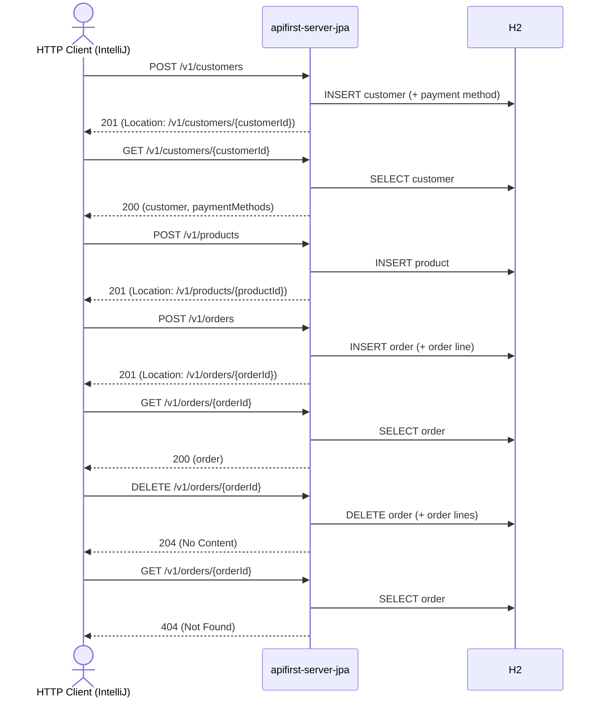

# order Flow: createCustomer → createProduct → createOrder → getOrderById → deleteOrderById → getOrderById (404)

Datei: `restRequest/order-flow-create-get-delete/order-flow-create-get-delete.http`

## Ziel

Eine frische Bestellung anlegen, holen, löschen und das Löschen verifizieren — deterministisch, mit
eigens angelegtem Kunden (inkl. Zahlungsmethode) und Produkt.

## Voraussetzung

Nur mit dem JPA-Profil lauffähig (`local-with-jpa` = 8082, `k8s-wiht-jpa` = 30082):
`DELETE /v1/orders/{orderId}` ist in `apifirst-server` nicht implementiert.

## Ablauf (Services)

## Requests (in dieser Reihenfolge)

1. `createCustomer` – legt einen frischen Kunden inkl. Zahlungsmethode an; `customerId` kommt aus dem
   `Location`-Header.
2. `getCustomerById` – holt den Kunden und speichert `paymentMethods[0].id` als `paymentMethodId`.
3. `createProduct` – legt ein frisches Produkt an; `productId` kommt aus dem `Location`-Header.
4. `createOrder` – erzeugt die Bestellung mit einer Order-Line; `orderId` kommt aus dem
   `Location`-Header.
5. `getOrderById` – holt die Bestellung per `orderId`.
6. `deleteOrderById` – löscht die Bestellung per `orderId`.
7. `getOrderById` – bestätigt `404 Not Found`.

## Benötigte Globals

|       Global        |          gesetzt von           |           genutzt von            |
|---------------------|--------------------------------|----------------------------------|
| `customerId`        | `createCustomer` (Location)    | `getCustomerById`, `createOrder` |
| `paymentMethodId`   | `getCustomerById`              | `createOrder`                    |
| `productId`         | `createProduct` (Location)     | `createOrder`                    |
| `orderId`           | `createOrder` (Location)       | alle folgenden Requests          |
| `traceId`, `spanId` | `../../scripts/traceparent.js` | alle Requests                    |

## Asserts

- `createCustomer` → `201`, `Location`-Header gesetzt.
- `getCustomerById` → `200`, Kunde hat mindestens eine Zahlungsmethode.
- `createProduct` → `201`, `Location`-Header gesetzt.
- `createOrder` → `201`, `Location`-Header gesetzt.
- `getOrderById` → `200`, `id` entspricht `{{orderId}}`, genau eine Order-Line mit
  `orderQuantity` = 2.
- `deleteOrderById` → `204`.
- `getOrderById` (nach Delete) → `404`.

## Hinweise

- Die Bestellung wird mit einer eigens angelegten Order-Line gelöscht; Order-Lines werden mit der
  Bestellung entfernt.
- Kunde und Produkt bleiben nach dem Flow bestehen (kein Cleanup, um Folgerequests nicht zu
  beeinflussen).
- `createOrder` liefert einen leeren Body; die neue ID steht nur im `Location`-Header.
- Die Kategorie des Produkts kommt aus der Environment-Variable `{{product-category-code}}`
  (JPA-Profil = `ELECTRONICS`).

