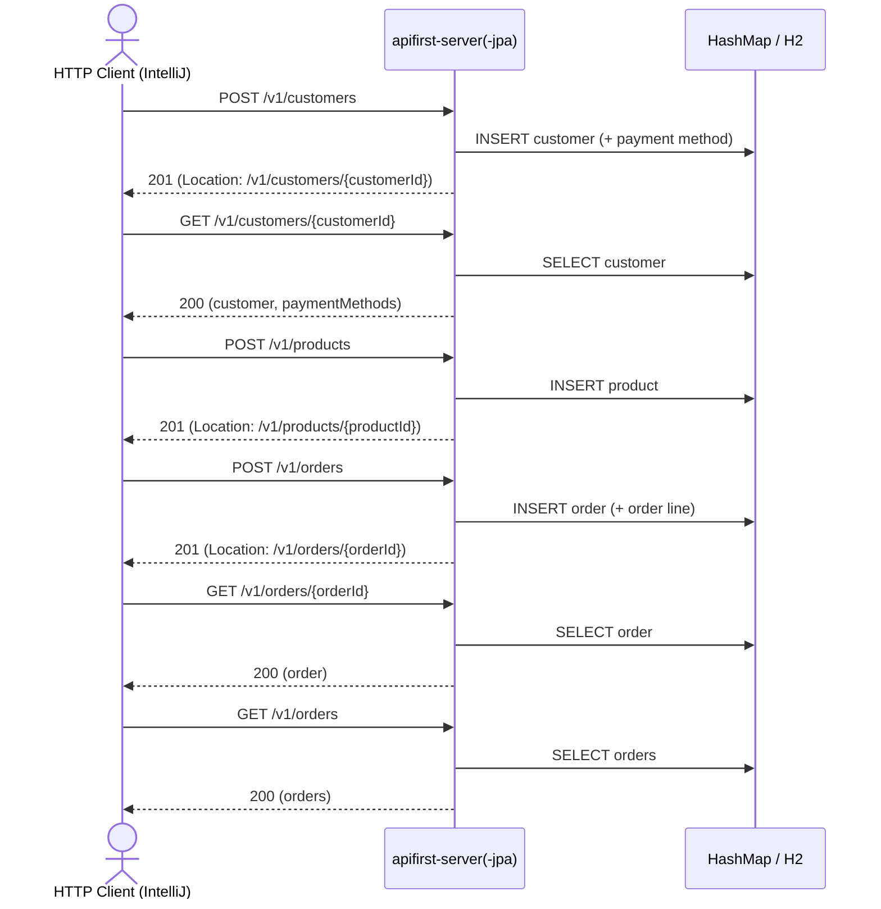

# order Flow: createCustomer → createProduct → createOrder → getOrderById → listOrders

Datei: `restRequest/order-flow-create-get-list/order-flow-create-get-list.http`

## Ziel

Einen frischen Kunden mit Zahlungsmethode und ein frisches Produkt anlegen, daraus eine Bestellung
erzeugen, per ID abrufen und in der Liste wiederfinden. Läuft auf beiden Profilen
(`local` = `apifirst-server`, `local-with-jpa` = `apifirst-server-jpa`).

## Ablauf (Services)

## Requests (in dieser Reihenfolge)

1. `createCustomer` – legt einen frischen Kunden inkl. Zahlungsmethode an; `customerId` kommt aus dem
   `Location`-Header.
2. `getCustomerById` – holt den Kunden und speichert `paymentMethods[0].id` als `paymentMethodId`.
3. `createProduct` – legt ein frisches Produkt an; `productId` kommt aus dem `Location`-Header.
4. `createOrder` – erzeugt die Bestellung mit einer Order-Line; `orderId` kommt aus dem
   `Location`-Header.
5. `getOrderById` – holt die Bestellung per `orderId`.
6. `listOrders` – prüft, dass die Bestellung in der Liste enthalten ist.

## Benötigte Globals

|       Global        |         gesetzt von         |                   genutzt von                    |
|---------------------|-----------------------------|--------------------------------------------------|
| `customerId`        | `createCustomer` (Location) | `getCustomerById`, `createOrder`, `getOrderById` |
| `paymentMethodId`   | `getCustomerById`           | `createOrder`                                    |
| `productId`         | `createProduct` (Location)  | `createOrder`                                    |
| `orderId`           | `createOrder` (Location)    | `getOrderById`, `listOrders`                     |
| `traceId`, `spanId` | `../scripts/traceparent.js` | alle Requests                                    |

Die Kategorie des Produkts kommt aus der Environment-Variable `{{product-category-code}}`
(`apifirst-server` = `Electronics`, `apifirst-server-jpa` = `ELECTRONICS`).

## Asserts

- `createCustomer` → `201`, `Location`-Header gesetzt.
- `getCustomerById` → `200`, Kunde hat mindestens eine Zahlungsmethode.
- `createProduct` → `201`, `Location`-Header gesetzt.
- `createOrder` → `201`, `Location`-Header gesetzt.
- `getOrderById` → `200`, `id` entspricht `{{orderId}}`, `customer.id` entspricht `{{customerId}}`,
  genau eine Order-Line mit `orderQuantity` = 2.
- `listOrders` → `200`, Liste enthält `{{orderId}}`.

## Hinweise

- Eine Bestellung benötigt `customerId`, `selectPaymentMethodId` (muss zu einer Zahlungsmethode des
  Kunden passen) und mindestens eine Order-Line mit `productId` und `orderQuantity`.
- `createOrder` liefert einen leeren Body; die neue ID steht nur im `Location`-Header.
- Die Zahlungsmethode wird erst nach dem `GET` des Kunden sichtbar (IDs werden beim Anlegen
  vergeben).
- `createCustomer`/`createProduct` liefern `201` mit leerem Body; Details nur über den
  `Location`-Header.

