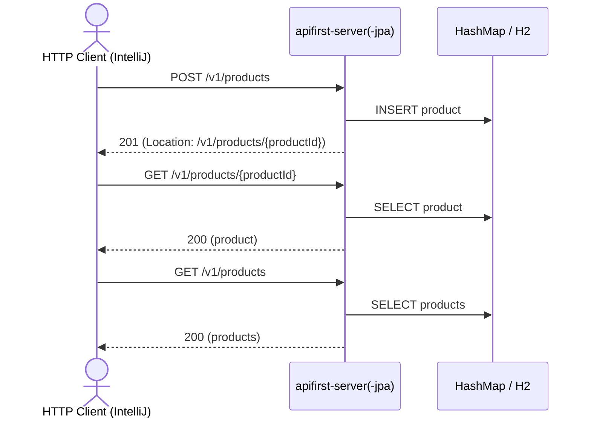

# product Flow: createProduct → getProductById → listProducts

Datei: `restRequest/product-flow-create-get-list/product-flow-create-get-list.http`

## Ziel

Ein frisches Produkt anlegen, per ID abrufen und in der Liste wiederfinden. Läuft auf beiden
Profilen (`local` = `apifirst-server`, `local-with-jpa` = `apifirst-server-jpa`).

## Ablauf (Services)

## Requests (in dieser Reihenfolge)

1. `createProduct` – legt ein frisches Produkt an; das Post-Request-Skript liest `productId` aus dem
   `Location`-Header.
2. `getProductById` – holt das Produkt per `productId`.
3. `listProducts` – prüft, dass das angelegte Produkt in der Liste enthalten ist.

## Benötigte Globals

|       Global        |         gesetzt von         |           genutzt von            |
|---------------------|-----------------------------|----------------------------------|
| `productId`         | `createProduct` (Location)  | `getProductById`, `listProducts` |
| `traceId`, `spanId` | `../scripts/traceparent.js` | alle Requests                    |

## Asserts

- `createProduct` → `201`, `Location`-Header gesetzt, `productId` lesbar.
- `getProductById` → `200`, `id` entspricht `{{productId}}`, Beschreibung/Preis entsprechen dem
  Payload.
- `listProducts` → `200`, Liste enthält `{{productId}}`.

## Hinweise

- Basis-URL ist `{{application-port}}` (Profil `local` = 8081, `local-with-jpa` = 8082,
  `k8s` = 30081, `k8s-with-jpa` = 30082).
- `createProduct` liefert einen leeren Body; die neue ID steht nur im `Location`-Header.
- `description` ist Pflicht (`3..255` Zeichen), `price`/`cost` sind Strings.
- Kategorien werden über den `categoryCode` referenziert. Der Code unterscheidet sich je Profil
  (`apifirst-server`: `Electronics`/`Gifts`, `apifirst-server-jpa`: `ELECTRONICS`/`CLOTHING`/
  `DRYGOODS`) und kommt deshalb aus der Environment-Variable `{{product-category-code}}`
  (`local`/`k8s` = `Electronics`, `local-with-jpa`/`k8s-with-jpa` = `ELECTRONICS`).
- `getProductById` liefert `404 Not Found`, wenn das Produkt nicht existiert.

