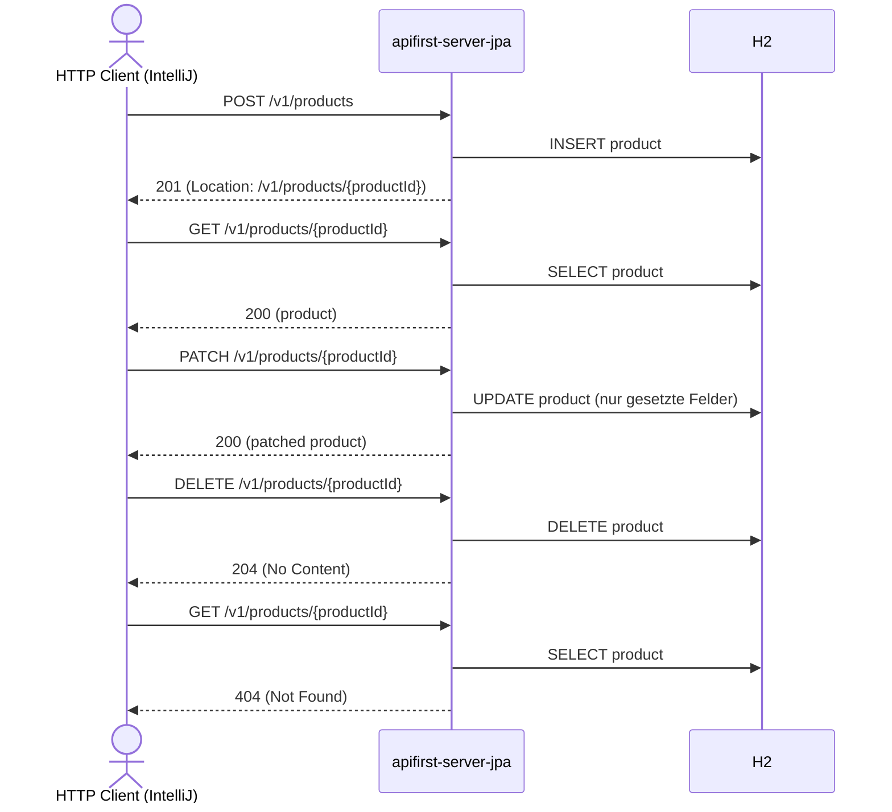

# product Flow: createProduct → getProductById → patchProductById → deleteProductById → getProductById (404)

Datei: `restRequest/product-flow-create-patch-delete/product-flow-create-patch-delete.http`

## Ziel

Ein frisches Produkt anlegen, holen, partiell aktualisieren (PATCH) und wieder löschen — ohne
Konflikt mit bestehenden Bestellungen.

## Voraussetzung

Nur mit dem JPA-Profil lauffähig (`local-with-jpa` = 8082, `k8s-wiht-jpa` = 30082):
`PATCH`/`DELETE` sind in `apifirst-server` nicht implementiert.

## Ablauf (Services)

## Requests (in dieser Reihenfolge)

1. `createProduct` – legt ein frisches Produkt an; `productId` kommt aus dem `Location`-Header.
2. `getProductById` – holt das Produkt per `productId`.
3. `patchProductById` – setzt `description` und `price`; `cost` bleibt erhalten.
4. `deleteProductById` – löscht das Produkt.
5. `getProductById` – bestätigt `404 Not Found`.

## Benötigte Globals

|       Global        |          gesetzt von           |       genutzt von       |
|---------------------|--------------------------------|-------------------------|
| `productId`         | `createProduct` (Location)     | alle folgenden Requests |
| `traceId`, `spanId` | `../../scripts/traceparent.js` | alle Requests           |

## Asserts

- `createProduct` → `201`, `Location`-Header gesetzt.
- `getProductById` → `200`, `id` entspricht `{{productId}}`.
- `patchProductById` → `200`, `description` gepatcht, `cost` weiterhin gesetzt.
- `deleteProductById` → `204`.
- `getProductById` (nach Delete) → `404`.

## Hinweise

- Ein Produkt, das in einer Bestellung referenziert wird, liefert beim Löschen `409 Conflict`
  (siehe `ProductServiceImpl.deleteProduct`). Deshalb wird hier ein frisches Produkt angelegt.
- Beim PATCH werden nur die gesendeten Felder übernommen (`NullValuePropertyMappingStrategy.IGNORE`).
- Die Kategorie kommt aus der Environment-Variable `{{product-category-code}}`
  (JPA-Profil = `ELECTRONICS`).

